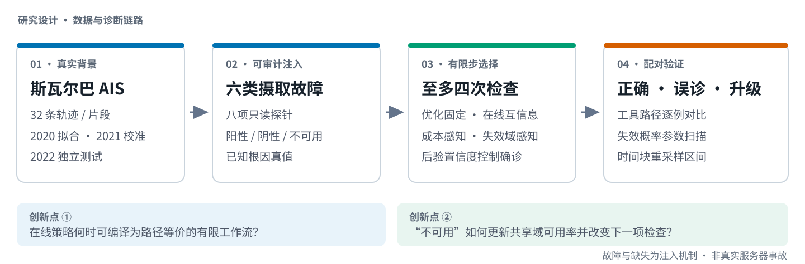
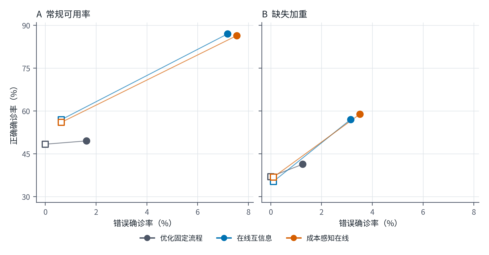
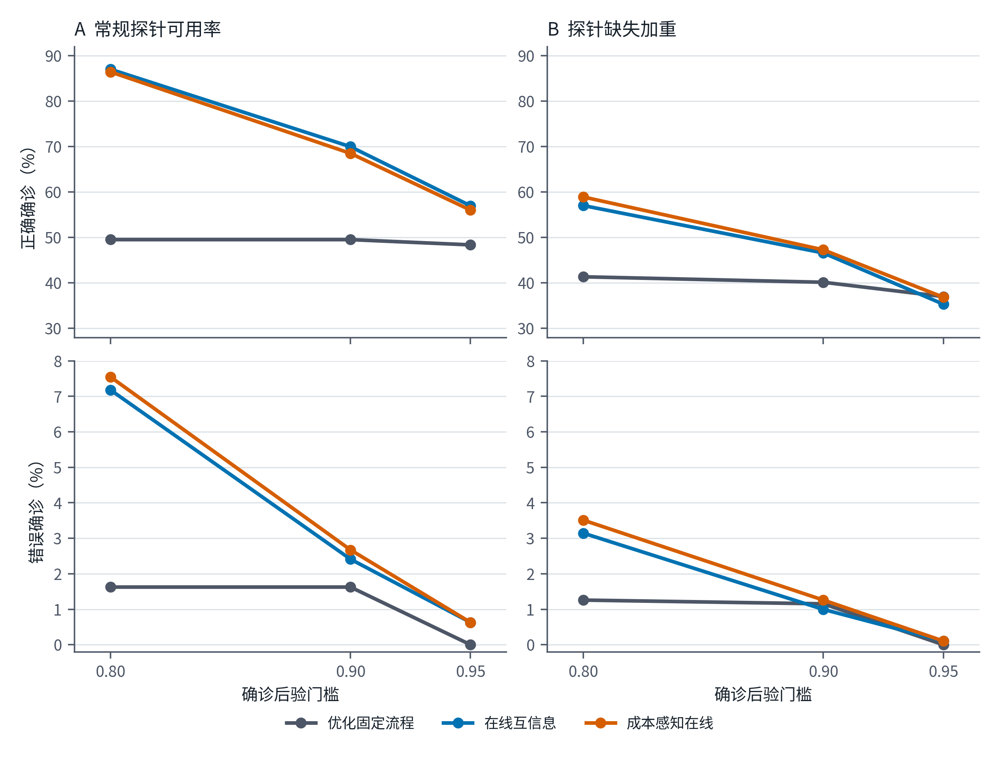
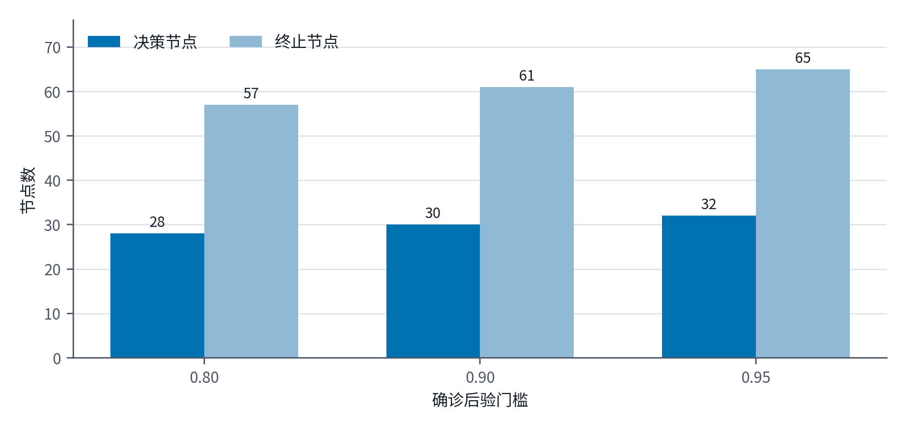
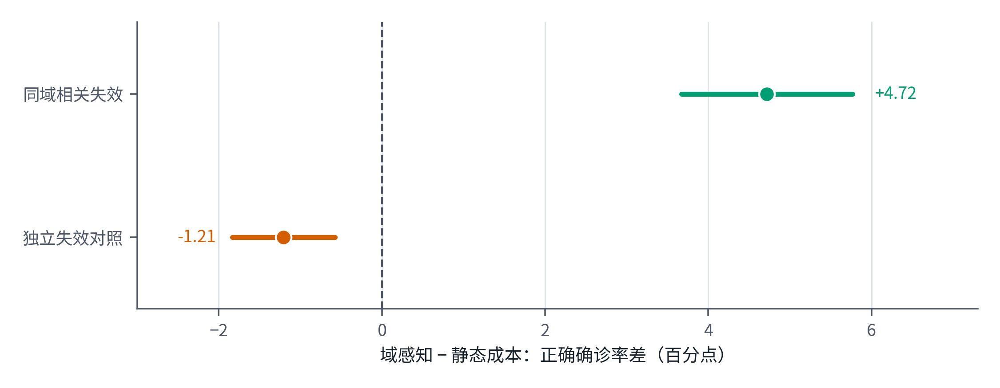
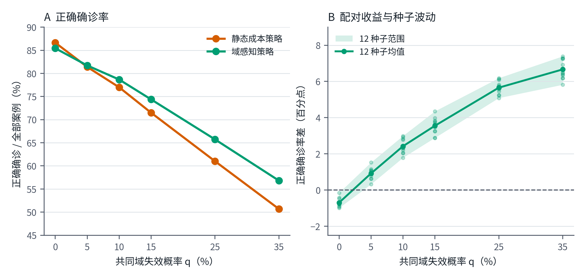

# 缺失探针下 AIS 数据摄取故障的有限步诊断策略

## 摘要

**问题。** 在 AIS 数据摄取异常时，固定工作流是否足以诊断根因，还是必须根据已经取得的证据在线选择下一项检查？本文把问题限定为六类数据链路故障、八项只读检查和最多四次调用，并研究在线策略何时能预编译为确定性工作流。**方法。** 使用公开的斯瓦尔巴 AIS 轨迹提供真实的时间、位置和船型背景，在轨迹摄取层注入六类有已知真值的故障；2020 年案例用于估计探针模型，2021 年案例用于选择固定流程和校准可用率，2022 年案例独立评估。分别比较穷举优化的固定顺序、贝叶斯在线互信息策略、成本感知策略以及在线策略的预编译决策树。**结果。** 在 1,908 个 2022 年半合成案例上，正常探针可用率、置信度门槛 0.8 时，优化固定顺序正确确诊 945 例，在线策略 1,660 例；探针缺失加重后分别为 789 与 1,088 例。按 53 个连续时间块重采样，在线与固定策略的正确确诊率差分别为 37.47 和 15.67 个百分点，95% 区间分别为 35.80–39.10、13.52–17.77。冻结参数后，编译版与在线版在所有案例的工具路径完全一致；但门槛 0.95、缺失加重时，优化固定顺序比在线策略多正确确诊 32 例。补充的共享日志域失效压力测试显示，利用缺失结果重排检查可改善确诊；独立失效对照则出现反向损失。**结论。** 在线适应的收益取决于可用率、失效依赖和风险门槛；在固定模型与有限预算下，在线选择可以精确编译。结果针对注入故障，尚不能推断真实课题组服务器事故的诊断性能。

**补充稳健性检验。** 服务器 CPU 对共同域失效概率 0%–35% 做了六档扫描；原始种子的域感知正确率差从独立失效时的 −1.21 个百分点变为 35% 共同域失效时的 +6.13 个百分点。另 12 个失效种子在 10%–35% 四档均呈正收益；5% 设置的原始时间块区间跨零。这些重复只检验注入缺失的随机性。

**关键词：** AIS；数据质量；故障诊断；工具选择；工作流编译；缺失观测

## 1 引言

课程第 3 讲讨论了“AI 智能体也是分布式系统”：工具调用要考虑失败、重放、状态、成本与审计。“工作流和 Agent 的边界”若仅以名称区分，就没有可复核的判定标准。本文把问题收缩为一项可计算的诊断任务：观察 AIS 数据摄取异常时，在预算有限且部分检查不可用的条件下，如何决定检查顺序，并确定何时输出根因、何时交给人工。

AIS 研究已系统梳理轨迹挖掘与异常检测任务[3,4]，也提出无监督海事态势感知方法[6]；但 AIS 接收或开关状态引起的观测缺口[5]，与船舶本身的异常行为不能直接等同。工具型智能体文献中的推理—行动循环和工具调用[20,21]提供了顺序决策的概念背景；本文检验的是一个带有已知注入真值的摄取故障诊断问题，而非复现这些语言模型方法。

研究问题有两个。**RQ1：** 与经过校准集穷举优化的固定检查顺序相比，依据已见证据在线选择工具是否改善正确确诊，同时如何改变误诊和人工升级？**RQ2：** 冻结根因先验、探针似然、预算和门槛后，在线策略能否预先展开为有限决策树，并在独立测试案例上实现逐例路径一致？附加问题是成本与探针可用率是否改变 RQ1 的答案。

本报告的两个方法贡献分别是：① 把在线与工作流的界限表述为**路径等价性、树规模和环境参数是否固定**；② 在同一诊断预算下评估**信息量、返回可用率与调用成本**的联合调度，并让探针不可用的结果反过来更新共享失效域的选择优先级。它们是课程项目中的方法探索，**不是已验证的顶刊新算法**。量化证据与适用条件如下。

| 创新点 | 可检验主张 | 2022 年测试证据 | 必须保留的反例或边界 |
|---|---|---|---|
| ① 在线决策的可编译界限 | 固定模型与四步预算下，在线选探针能预展开为有限工作流 | 正常可用率、门槛 0.8：在线比最优固定多正确 715/1,908 例，配对差 +37.47 个百分点；三个门槛、两种缺失设置共 11,448 个案例逐条工具路径一致，决策节点仅 28–32 个 | 门槛 0.95 且缺失加重时，固定流程反超 32 例；改变概率表或工具后必须重新编译 |
| ② 利用失败反馈的失效域调度 | 探针返回“不可用”时，按共享数据源修正其他探针的可用率 | 共同域失效概率 25%：相对静态成本策略多正确 90/1,908 例，+4.72 个百分点（53 块重采样 95% 区间 +3.67 至 +5.77）；CPU 扫描显示在 10%–35% 设置下区间均高于零 | 独立失效时少正确 23 例；5% 设置的区间跨零。共享域结构、失效概率与故障标签均为注入假设 |



**研究设计示意图。** 上部是数据、故障注入、有限步选择与配对验证的顺序；下部明确两项创新各自回答的问题。此图为可缩放的 SVG，可导入桌面版 Visio 做版面调整；若要逐个修改框中文字，仍需在 Visio 中重建原生形状。实验数值以结果 JSON 和后文数据图为准。

### 1.1 为什么原先的真实 AIS 结果不能证明主张

已有工程在 2022 年真实轨迹异常标签上，以训练正常样本第 99 百分位为阈值，对 16 条异常轨迹检出 **0 条**。这不是可以通过行文掩盖的结果。公开数据说明，这 16 条标签来自 2022 年海底电缆事件中两艘船的 11 条和 5 条轨迹；它们衡量的是**船舶行为异常**，而本文的根因是**数据摄取链路故障**，两套标签不能互相验证[1,2]。我们又试验了按船型和邻近位置选择历史轨迹的条件化行为距离，真实异常的阈值检出仍为 0/16（ROC AUC 0.301）；因此停止把这项异常检测当作主论文的效果证据。该结果作为失败分析保留，附带 `real_ais_context_result.json` 和 `contextual_ais.py`。

## 2 数据、故障与有效性边界

### 2.1 真实数据背景与时间划分

服务器工程使用公开数据的 35,000 条轨迹副本，字段包括 MMSI、船型、经纬度、速度、航向和 UTC 时间戳。官方发布版说明其区域为斯瓦尔巴，原始发布量为 35,055 条，轨迹经两分钟重采样；因此本工程副本与发布总量不完全相同，复现实验应以项目文件校验和为准[1]。本实验只选原标签为正常的轨迹作为故障注入底座，避免把行为异常混进摄取故障信号。

每年先按第一条消息的时间排序，再将连续的 32 条轨迹划为一个不重叠底座片段；每个片段分别注入六类故障。2020 年有 340 个片段、2,040 个注入案例，用于估计探针似然；2021 年有 434 个片段、2,604 个案例，用于固定流程选型与可用率校准；2022 年有 318 个片段、**1,908 个最终测试案例**。时间或空间结构化数据需要尊重依赖关系设计验证划分[13]；相同片段产生的六个故障案例相关，因此统计区间按片段及连续片段块计算，不把 1,908 个案例当作彼此独立。

### 2.2 六类故障与八项检查

| 故障真值 | 注入操作 | 主要可观测变化 |
|---|---|---|
| 接收丢失 | 随机丢弃约 35%–55% 轨迹 | 下游计数减少 |
| 西侧接收丢失 | 优先丢弃片段西侧约 70%–95% 的轨迹 | 计数减少，空间构成偏移 |
| 船型过滤变化 | 优先丢弃片段中数量最多的船型 | 计数与船型构成改变 |
| 重放重复 | 复制约 30%–50% 的轨迹 | 计数与重复标识增加 |
| 事件时间偏移 | 将时间戳移动约 1–2 小时 | 源端与下游事件时间不一致 |
| 到达积压 | 让部分轨迹到达延迟约 1–3 小时 | 延迟比例上升 |

八项二值只读检查依次为：总量下降、总量上升、重复 ID、船型构成偏移、空间构成偏移、事件时钟偏移、到达延迟、西侧轨迹占比偏移。它们由注入前后的成对元数据计算；阈值与注入范围写在附带源码中。该设置相当于拥有上游与下游审计计数的轨迹摄取系统，**不代表真实服务器已经记录这些检查值**。一些故障拥有近乎唯一的检查信号，因此这个半合成基准比真实运维更容易；若上游计数缺失或多故障同时发生，本文的效能可能明显下降。

把数据质量检查写成可执行约束以及在机器学习管道中验证输入数据，已有成熟的工程方法[7,8]。本文八项检查借鉴的是这种“可审计探针”设计思想，具体故障注入、阈值和成功率均由本实验定义与测量。探针不可用也未必是随机事件；缺失机制会影响可从已观测数据推出的结论[9]，因此第 5 节单独检验相关失效。

## 3 方法

### 3.1 状态更新与决策

六类根因的先验相同。2020 年每类注入案例产生探针的正例频率，并用加一平滑估计伯努利似然。每次返回阳性或阴性后，按贝叶斯公式更新六维后验；不可用检查记为第三种结果，不更新后验，但消耗一次调用。最多调用四次工具；至少取得两项有效观测且最大后验不低于门槛，才输出最可能根因，否则升级人工。报告门槛 0.8、0.9、0.95 的敏感性结果。

比较四种执行策略：**贪心固定流程**按初始互信息排序；**优化固定流程**在 2021 年校准集穷举全部 `8P4=1,680` 个固定顺序，先最大化正确确诊数，再以错误确诊数及成本打破平局；**在线互信息**每步选剩余工具中当前互信息最大者；**成本感知在线**选 `互信息 × 估计可用率 ÷ 相对调用成本` 最大者。用预期信息量选择下一项观察有信息论依据[10]，有限预算下的观察选择也有组合优化研究[11]；本文的贪心和成本公式是自己的启发式，**不继承**文献[11]的近似最优保证。相对成本由研究者设定，不是真实服务器的收费或耗时测量。正常缺失率为每项 5%；退化情形为预设的非均匀 15%–45% 缺失。2021 年独立案例只估计可用率，2022 年测试标签不参与策略选择。

### 3.2 预编译与统计设计

对在线互信息策略，枚举每次检查的“阳性、阴性、不可用”三种结果，按照相同停止规则递归展开决策树；冻结的概率表、预算与门槛是编译键。对测试集中每个案例，比较编译执行与 GPU 在线执行的**完整工具路径**，不只比较最终准确数。正确确诊、错误确诊、人工升级的分母都是全部测试案例。主差值使用同一案例的配对结果；补充的 95% 区间通过 4,000 次重采样 **53 个连续六片段时间块** 得到。块重采样针对相关观测的思想见[12]，结构化验证划分的风险见[13]；本实验的块长是研究者设定，并未证明能完全消除依赖。由于船舶可跨块出现，这仍不是跨独立事件的泛化区间。

## 4 结果

### 4.1 主结果

门槛 0.8；每种设置有 1,908 个测试案例。表中成本是每案例模拟相对单位的平均值。

| 探针状态 | 策略 | 正确确诊 | 错误确诊 | 人工升级 | 平均调用 | 平均成本 |
|---|---|---:|---:|---:|---:|---:|
| 正常 | 贪心固定 | 945 | 31 | 932 | 3.37 | 4.82 |
| 正常 | 优化固定 | 945 | 31 | 932 | 3.22 | 4.75 |
| 正常 | 在线互信息 | 1,660 | 137 | 111 | 2.97 | 4.24 |
| 正常 | 成本感知在线 | 1,649 | 144 | 115 | 2.98 | 3.96 |
| 退化 | 贪心固定 | 716 | 17 | 1,175 | 3.64 | 5.32 |
| 退化 | 优化固定 | 789 | 24 | 1,095 | 3.63 | 5.03 |
| 退化 | 在线互信息 | 1,088 | 60 | 760 | 3.48 | 5.17 |
| 退化 | 成本感知在线 | 1,124 | 67 | 717 | 3.41 | 4.60 |



**图 1.** 每点是同一批 1,908 个案例上的一种策略与确诊门槛组合；实心圆为 0.80，空心方块为 0.95，同色线仅连接同一策略的两个门槛。横轴是错误确诊占全部案例的比例，纵轴是正确确诊占全部案例的比例，两面板使用相同坐标范围。右下角低误诊的几个方块接近，精确值见下表。向左上方移动较好，但人工升级和调用成本仍需另行考虑。[SVG 矢量版](paper_figures/fig1_risk_tradeoff.svg)。

正常设置中，在线互信息比优化固定流程多正确确诊 **715 例，即 37.47 个百分点**；时间块重采样区间 **35.80–39.10 个百分点**。退化设置中多 **299 例，即 15.67 个百分点**，区间 **13.52–17.77 个百分点**。然而在线策略的错误确诊也分别多 106 和 36 例。按故障类型拆开看，优化固定流程在门槛 0.8 下对前三类“计数下降”故障均为 0/318，而在线策略在正常设置下分别正确确诊 208、279、229 例：固定四步顺序没有足够分支来区分这些相似症状。另一方面，固定流程对重复、时钟、积压三类接近全检出。这是在线优势的具体机制，而非模型规模带来的笼统提升。

成本感知在线策略在正常设置比互信息在线少正确 11 例、多误诊 7 例，但平均成本从 4.24 降至 3.96；退化设置多正确 36 例、多误诊 7 例，平均成本从 5.17 降至 4.60。因误诊业务代价未标定，不能把较低模拟成本解释为总体最优。

### 4.2 风险门槛与工作流边界

| 门槛 | 探针状态 | 优化固定 正确/误诊 | 在线互信息 正确/误诊 | 成本感知 正确/误诊 |
|---:|---|---:|---:|---:|
| 0.80 | 正常 | 945 / 31 | 1,660 / 137 | 1,649 / 144 |
| 0.80 | 退化 | 789 / 24 | 1,088 / 60 | 1,124 / 67 |
| 0.90 | 正常 | 945 / 31 | 1,335 / 46 | 1,307 / 51 |
| 0.90 | 退化 | 766 / 22 | 889 / 19 | 902 / 24 |
| 0.95 | 正常 | 923 / 0 | 1,087 / 12 | 1,069 / 12 |
| 0.95 | 退化 | **706 / 0** | 674 / 2 | 703 / 2 |



**图 2.** 上排为正确确诊率，下排为错误确诊率；列对应两种探针可用率。所有分母均为 1,908 个测试案例，纵轴在两列中统一。0.95 门槛且缺失加重时，优化固定流程的正确确诊率反超在线互信息，这一反例阻止了“在线始终更优”的概括。[SVG 矢量版](paper_figures/fig2_gate_sensitivity.svg)。

门槛提高会减少错误确诊，但也让更多案例升级人工。特别是在退化设置、门槛 0.95 时，优化固定流程比在线互信息**多正确 32 例**，且未发生错误确诊；在线与固定正确确诊率差为 **−1.68 个百分点**，53 块重采样区间 **−2.99 至 −0.37 个百分点**。因此“在线始终优于工作流”不成立。该反转也说明只报门槛 0.8 会产生选择性结论。置信门槛的解释依赖后验校准；概率校准与选择性预测文献分别给出检查置信度和拒答—覆盖权衡的框架[14,15]。本文只报告了三个门槛的经验结果，尚未验证完整校准曲线或给出运维损失函数。

门槛为 0.8、0.9、0.95 时，预编译树分别有 **28/57、30/61、32/65 个决策/终止节点**。正常与退化两种缺失设置下，编译版与在线互信息版在每个案例的工具路径均通过逐例断言。这证明了**冻结模型、有限预算**时的精确可编译性；不证明编译树对概率、成本、工具集合改变后仍有效。近期工作流综述区分静态模板、运行时图与实际轨迹[23]；动态成本和工具阻断也被工具规划基准列为评估维度[22]。这些文献界定了研究问题，并非本文路径等价性的外部验证。



**图 3.** 不同确诊门槛下的编译树节点数。三个门槛、两种缺失设置合计 11,448 个测试案例，编译与在线策略的完整工具路径全部相同。柱高表示储存规模，不表示真实运行时延迟；本研究未测量编译和在线执行的端到端耗时。[SVG 矢量版](paper_figures/fig3_compilation.svg)。

## 5 前沿技术、争议与补充压力测试

### 5.1 技术演进及其对本课题的含义

近期工具规划研究从单步贪心选择，走向考虑多步路径、成本变化和执行反馈。**CostBench** 将工具阻断和成本改变纳入多轮评估[22]；**ToolTree** 通过树搜索与剪枝处理工具依赖[24]；**FlowScout** 用执行反馈修正工具型工作流[25]。它们研究的主要是通用工具型智能体，不能直接证明某个 AIS 诊断策略有效，但提示了本实验中“已知探针似然 + 单步互信息”之外的下一步：比较有限预算的前瞻搜索，并检验运行日志改变后何时重新编译。

另一个争议是**高置信度是否等于可靠确诊**。选择性分类研究指出，单调的事后概率校准通常不改变错误案例的排序；只调一个门槛难以消除底层模型的排序问题[16]。数据分布变化时，模型的不确定性质量也可能下降[17]。这与本文门槛 0.8、0.9、0.95 下的正确、误诊和升级反转形成方法层面的联系，不能把其他模型或数据集上的结果当作本文的实验证明。实际运维应先确定错误确诊、人工升级和检查耗时的代价，再选择工作点。

最贴近本实验的争议是**探针独立性**。同一上游计数服务失效时，“总量下降”“船型构成”“空间构成”等检查可能一起不可用；一个失败返回本身就提供了关于其他工具可用性的信息。诊断检验的条件相关性若被忽略，会导致偏误，这在其他诊断领域已有明确警示[18]；缺失机制也会影响可识别的推断[9]。两篇文献提供跨领域的方法提醒；AIS 现场是否具有同样的相关结构仍须由真实日志验证。

### 5.2 自己提出的共享失效域策略

作为第二个贡献的延伸，我们把八项探针按**预设数据来源**归入三个域：上游计数/构成域 `{0,1,3,4,7}`、去重域 `{2}`、时间与到达域 `{5,6}`。压力测试为每个测试案例抽取共同域失效，再叠加 5% 独立单探针失效；三个域的共同失效概率设为 25%、8%、25%。静态成本策略只使用 2021 年校准集的平均可用率。新策略在某项探针返回“不可用”后，将同域剩余探针的估计可用率降到 0.05，再按 `互信息 × 可用率 ÷ 成本` 选下一项。这里的 0.05 与域失效概率是**实验假设**，不是实测服务器故障率。

为了避免该规则在独立失效时反而有害，加入一个可回退门控：只用 2021 年校准集计算同域探针缺失指示变量的平均相关系数；超过 0.2 才启用域感知策略，否则沿用静态成本策略。门槛 0.2 是本轮探索中提出的启发式，**尚未在新的独立事故集预注册验证**。

### 5.3 正反对照结果

门槛 0.8、2022 年 1,908 个案例；固定顺序同样只在 2021 年案例上穷举。相关失效设置与独立失效负对照使用不同缺失机制，不能跨行直接比较绝对正确数。

| 失效机制 | 策略 | 正确确诊 | 错误确诊 | 人工升级 | 平均模拟成本 |
|---|---|---:|---:|---:|---:|
| 同域相关 | 优化固定 | 733 | 16 | 1,159 | 5.16 |
| 同域相关 | 在线互信息 | 1,222 | 90 | 596 | 4.79 |
| 同域相关 | 静态成本感知 | 1,164 | 93 | 651 | 4.34 |
| 同域相关 | 域感知 | **1,254** | 93 | 561 | 4.42 |
| 独立失效 | 静态成本感知 | **1,653** | 144 | 111 | 3.95 |
| 独立失效 | 域感知 | 1,630 | 142 | 136 | 3.97 |



**图 4.** 域感知相对静态成本策略的配对正确确诊率差；横线为按 53 个连续时间块重采样的 95% 区间，虚线为零差异。相关失效下收益为正，独立失效下损失为负；两行来自不同的注入缺失机制，不是实测服务器事故。[SVG 矢量版](paper_figures/fig4_failure_domain.svg)。

在相关失效中，域感知比静态成本策略多正确 **90 例，即 4.72 个百分点**，按 53 个连续时间块的 95% 重采样区间为 **3.67–5.77 个百分点**；错误确诊同为 93 例，平均成本略高 0.07。若失效实际独立，域感知反而少正确 **23 例，即 −1.21 个百分点**，区间 **−1.83 至 −0.58**。2021 年校准集的同域缺失相关系数在两种机制下分别为 **0.820** 和 **0.0039**，门控因而分别选择域感知和静态策略。这个正反对照说明“利用失败反馈”有条件地有益；本轮门控只是探索性保护，不是对未知服务器故障模式的可靠保证。源码 `failure_domain_study.py` 与两份结果 JSON 一并提交。

### 5.4 CPU 参数扫描：收益何时出现

为避免只选 25% 的有利设置，固定同一批 2022 年案例和每个设置的随机数生成规则，把计数/构成域与时间域的共同失效概率 `q` 从 0 扫到 35%；去重域设为 `0.32q`，各探针额外叠加 5% 独立失效。2021 年案例只用于估计可用率和同域缺失相关性，2022 年案例只用于最终评估。第 7 卡当时高负载，此扫描使用服务器 **CPU**，与上节 GPU 结果在 `q=0` 和 `q=0.25` 的正确确诊数逐项一致。

| 共同域失效概率 q | 校准集同域缺失相关 | 静态正确 | 域感知正确 | 配对正确率差及 95% 区间（百分点） | 门控选择 |
|---:|---:|---:|---:|---:|---|
| 0% | 0.004 | 1,653 | 1,630 | −1.21 [−1.83, −0.58] | 静态 |
| 5% | 0.495 | 1,553 | 1,559 | +0.31 [−0.37, +1.00] | 域感知 |
| 10% | 0.661 | 1,469 | 1,501 | +1.68 [+0.84, +2.52] | 域感知 |
| 15% | 0.737 | 1,364 | 1,419 | +2.88 [+1.99, +3.77] | 域感知 |
| 25% | 0.820 | 1,164 | 1,254 | +4.72 [+3.67, +5.77] | 域感知 |
| 35% | 0.865 | 967 | 1,084 | +6.13 [+4.98, +7.39] | 域感知 |



**图 5.** 左：原始预设种子下两种策略的正确确诊率；右：另 12 个失效种子下的配对正确率差，浅点为单次结果，实线为均值，阴影为 12 次的最小值至最大值，**不是 95% 置信区间**。每次每档仍使用同一批 1,908 个 2022 年半合成案例。原始种子的时间块重采样区间见上表。[SVG 矢量版](paper_figures/fig5_domain_sweep.svg)。

| q | 另 12 种子平均差（百分点） | 最小–最大（百分点） | 域感知正确率更高的次数 | 校准门控选择域感知的次数 |
|---:|---:|---:|---:|---:|
| 0% | −0.70 | −1.00 至 −0.16 | 0/12 | 0/12 |
| 5% | +0.92 | +0.31 至 +1.52 | 12/12 | 12/12 |
| 10% | +2.42 | +1.78 至 +2.99 | 12/12 | 12/12 |
| 15% | +3.55 | +2.88 至 +4.35 | 12/12 | 12/12 |
| 25% | +5.66 | +5.08 至 +6.18 | 12/12 | 12/12 |
| 35% | +6.66 | +5.82 至 +7.39 | 12/12 | 12/12 |

此扫描表明创新点 ② 的收益随共享失效增强而扩大，且在所试的 12 个额外种子中方向稳定。种子重复只改变了**注入缺失**，没有带来新的海域、真实故障事件或独立船舶样本；因此不能把 12/12 当成真实部署成功率。门控阈值 0.2 仅在这些注入机制上检查过，未来需用独立日志确定阈值并做跨事故验证。

## 6 讨论与局限

**机制解释。** 本研究中的在线收益来自对同一“计数下降”初始症状进行后续分叉：观察到不同探针结果后，剩余预算才投入船型或空间检查。固定顺序即使在校准集穷举优化，也必须对所有案例使用相同四项检查。编译版则在部署前冻结这些分叉，因此在概率表和接口固定时，它仍是工作流；“Agent”不是性能提升的必要标签。

**外推边界。** 六类故障由我们注入；关键探针有时直接对应单一故障，例如时钟差与到达延迟。真实系统可能出现并发故障、上游计数缺失、非随机工具失败和随季节改变的船流。补充实验中的失效域也由我们指定；域感知策略在与假设匹配时占优、在独立失效时变差，不能把压力测试等同于真实日志验证。使用已公开 AIS 轨迹做底座提高了时间、空间、船型分布的真实性，但**没有产生真实服务器故障标签**。年际时间划分能测试真实轨迹背景的变化，却不能验证对另一片海域或另一套日志系统的迁移。正例船舶行为异常的 0/16 结果仍是独立失败，不因本实验正确率提高而消失。若要主张顶刊级泛化，至少还需要真实故障日志、独立海域或机构、并发故障测试、预注册的误诊代价和外部复现。

**下一步改进。** 以服务器真实的源端/接收端计数、去重、过滤和水位日志建立故障事件库，按事件和船舶/时间块切分；把误诊、升级和调用成本由运维人员预先赋权。邻近的云原生系统研究把异常之后的根因定位单独建模[19]，提示应验证本研究的六类摄取故障是否覆盖真实事故。随后比较本研究的单步互信息与考虑后续预算的动态规划，报告覆盖率—误诊率—成本前沿，而不是从测试集挑一个最好看的阈值。上述工作尚未完成，不能写成已实现的实验结果。

## 7 复现说明

服务器工程路径为 `/home/chenbingqi/ais-agent-tensorflow-20261112`；源文件 `ais_fault_study.py`，原始轨迹 `formatted_trajectories.json.gz`，结果在 `fault_results/result_gate_*.json`。使用 `cupy-cuda11x 13.6.0`、CUDA 11.8 运行库，显式只暴露第 7 卡 RTX 3090。复现命令：

```bash
CUDA_VISIBLE_DEVICES=7 LD_LIBRARY_PATH=/usr/local/cuda-11.8/targets/x86_64-linux/lib \
  .venv/bin/python ais_fault_study.py --gate 0.8 --out fault_results/result_gate_0.8.json
```

另以 `--gate 0.9`、`--gate 0.95` 重复。源码固定了注入随机种子、缺失率、阈值、调用成本和 4,000 次重采样；结果 JSON 记录设备、分割样本量、似然矩阵、选中的固定顺序、节点数、逐案例路径断言、分故障正确数及统计区间。附带的 `gpu7_policy_study.py` 和其结果是较早的**完全合成**先导实验，不能与本文的半合成测试案例合并计算。课程资料为用户提供的《海洋数据挖掘》第 3 讲。

共享失效域压力测试同样使用第 7 卡运行：

```bash
CUDA_VISIBLE_DEVICES=7 LD_LIBRARY_PATH=/usr/local/cuda-11.8/targets/x86_64-linux/lib \
  .venv/bin/python failure_domain_study.py --gate 0.8 \
  --out fault_results/failure_domain_0.8.json
```

独立失效负对照把脚本中的 `DOMAIN_FAILURE` 三个分量设为 0，保留 5% 单探针失效；记录在 `failure_domain_control.json`。两个脚本都保存机器可读汇总，不上传含 MMSI 的中间缓存。补充实验的相关性门控是在本轮探索中形成的，复现可验证数字，仍需新事故数据验证其部署价值。

补充的 CPU 扫描可由 `CUDA_VISIBLE_DEVICES='' OPENBLAS_NUM_THREADS=1 .venv/bin/python innovation_sweep_cpu.py --replicates 12 --out fault_results/innovation_sweep_cpu.json` 复现。它不占用服务器 GPU。五张数据图由 `make_paper_figures.py` 从结果 JSON 直接生成，提供 SVG 矢量版和 320 dpi PNG；图中的数值与本节表格使用同一机器可读结果。绘图脚本显式选取 Noto Sans CJK 的**简体中文字体面**，修正“门槛”等文字此前因默认日文字形造成的显示问题。

## 参考文献

1. Skat-Rørdam H V, Kjærsgaard R D, Hovad E, Clemmensen L K H. [Labelled AIS Trajectories Near Svalbard for Abnormal Behavior Detection](https://orbit.dtu.dk/en/datasets/labelled-ais-trajectories-near-svalbard-for-abnormal-behavior-det/). Technical University of Denmark, 2025. DOI: 10.11583/dtu.28553462.v3.
2. Skat-Rørdam H V, et al. [SEAuAIS: A self-explainable autoencoder with AIS-based maritime anomaly detection](https://www.sciencedirect.com/science/article/pii/S002980182502339X). *Ocean Engineering*, 2025, 341: 122656. DOI: 10.1016/j.oceaneng.2025.122656.
3. Tu E, Zhang G, Rachmawati L, Rajabally E, Huang G B. [Exploiting AIS Data for Intelligent Maritime Navigation: A Comprehensive Survey From Data to Methodology](https://doi.org/10.1109/TITS.2017.2724551). *IEEE Transactions on Intelligent Transportation Systems*, 2018, 19(5): 1559–1582. DOI: 10.1109/TITS.2017.2724551.
4. Ribeiro C V, Paes A, de Oliveira D. [AIS-based maritime anomaly traffic detection: A review](https://www.sciencedirect.com/science/article/pii/S0957417423010631). *Expert Systems with Applications*, 2023: 120561. DOI: 10.1016/j.eswa.2023.120561.
5. Mazzarella F, Vespe M, Alessandrini A, et al. [A novel anomaly detection approach to identify intentional AIS on-off switching](https://www.sciencedirect.com/science/article/pii/S0957417417300933). *Expert Systems with Applications*, 2017, 78: 110–123. DOI: 10.1016/j.eswa.2017.02.011.
6. Liang M, Weng L, Gao R, Li Y, Du L. [Unsupervised maritime anomaly detection for intelligent situational awareness using AIS data](https://www.sciencedirect.com/science/article/pii/S0950705123010614). *Knowledge-Based Systems*, 2024, 284: 111313. DOI: 10.1016/j.knosys.2023.111313.
7. Schelter S, Lange D, Schmidt P, et al. [Automating Large-Scale Data Quality Verification](https://www.vldb.org/pvldb/vol11/p1781-schelter.pdf). *Proceedings of the VLDB Endowment*, 2018, 11(12): 1781–1794. DOI: 10.14778/3229863.3229867.
8. Polyzotis N, Zinkevich M, Roy S, Breck E, Whang S. [Data Validation for Machine Learning](https://proceedings.mlsys.org/paper_files/paper/2019/hash/928f1160e52192e3e0017fb63ab65391-Abstract.html). *Proceedings of Machine Learning and Systems*, 2019, 1.
9. Rubin D B. [Inference and missing data](https://doi.org/10.1093/biomet/63.3.581). *Biometrika*, 1976, 63(3): 581–592. DOI: 10.1093/biomet/63.3.581.
10. MacKay D J C. [Information-based objective functions for active data selection](https://authors.library.caltech.edu/records/efefp-2j353). *Neural Computation*, 1992, 4(4): 590–604. DOI: 10.1162/neco.1992.4.4.590.
11. Krause A, Guestrin C. [Near-optimal Observation Selection using Submodular Functions](https://cdn.aaai.org/AAAI/2007/AAAI07-265.pdf). *Proceedings of the AAAI Conference on Artificial Intelligence*, 2007: 1650–1654.
12. Künsch H R. [The Jackknife and the Bootstrap for General Stationary Observations](https://doi.org/10.1214/aos/1176347265). *The Annals of Statistics*, 1989, 17(3): 1217–1241. DOI: 10.1214/aos/1176347265.
13. Roberts D R, et al. [Cross-validation strategies for data with temporal, spatial, hierarchical, or phylogenetic structure](https://doi.org/10.1111/ecog.02881). *Ecography*, 2017, 40(8): 913–929. DOI: 10.1111/ecog.02881.
14. Guo C, Pleiss G, Sun Y, Weinberger K Q. [On Calibration of Modern Neural Networks](https://proceedings.mlr.press/v70/guo17a.html). *Proceedings of the 34th International Conference on Machine Learning*, 2017: 1321–1330.
15. Geifman Y, El-Yaniv R. [Selective Classification for Deep Neural Networks](https://proceedings.neurips.cc/paper/2017/hash/4a8423d5e91fda00bb7e46540e2b0cf1-Abstract.html). *Advances in Neural Information Processing Systems*, 2017.
16. Rabanser S, Papernot N. [What Does It Take to Build a Performant Selective Classifier?](https://proceedings.neurips.cc/paper_files/paper/2025/hash/71460926102fade443ea7ec89ae8a73a-Abstract-Conference.html). *Advances in Neural Information Processing Systems*, 2025, 38. DOI: 10.52202/085713-2635.
17. Ovadia Y, et al. [Can You Trust Your Model’s Uncertainty? Evaluating Predictive Uncertainty Under Dataset Shift](https://proceedings.neurips.cc/paper/2019/hash/8558cb408c1d76621371888657d2eb1d-Abstract.html). *Advances in Neural Information Processing Systems*, 2019.
18. Okkaoglu Y, Welton N J, Jones H E. [Detecting departures from the conditional independence assumption in diagnostic latent class models: a simulation study](https://pmc.ncbi.nlm.nih.gov/articles/PMC11619692/). *BMC Medical Research Methodology*, 2024, 24: 299. DOI: 10.1186/s12874-024-02432-x.
19. Wang P, et al. [CloudRanger: Root Cause Identification for Cloud Native Systems](https://doi.org/10.1109/CCGRID.2018.00076). *18th IEEE/ACM International Symposium on Cluster, Cloud and Grid Computing*, 2018. DOI: 10.1109/CCGRID.2018.00076.
20. Yao S, et al. [ReAct: Synergizing Reasoning and Acting in Language Models](https://arxiv.org/abs/2210.03629). *International Conference on Learning Representations*, 2023.
21. Schick T, et al. [Toolformer: Language Models Can Teach Themselves to Use Tools](https://proceedings.neurips.cc/paper/2023/hash/d842425e4bf79ba039352da0f658a906-Abstract-Conference.html). *Advances in Neural Information Processing Systems*, 2023.
22. Liu J, et al. [CostBench: Evaluating Multi-Turn Cost-Optimal Planning and Adaptation in Dynamic Environments for LLM Tool-Use Agents](https://arxiv.org/abs/2511.02734). arXiv:2511.02734, 2025.
23. Yue L, et al. [From Static Templates to Dynamic Runtime Graphs: A Survey of Workflow Optimization for LLM Agents](https://arxiv.org/abs/2603.22386). arXiv:2603.22386, 2026.
24. Yang S, et al. [ToolTree: Efficient LLM Agent Tool Planning via Dual-Feedback Monte Carlo Tree Search and Bidirectional Pruning](https://arxiv.org/abs/2603.12740). arXiv:2603.12740, 2026.
25. Hao S, Lu Y, Chen B, Peng X. [FlowScout: From Execution Feedback to Reliable Tool-Using Agent Workflows](https://arxiv.org/abs/2608.10039). arXiv:2608.10039, 2026.
